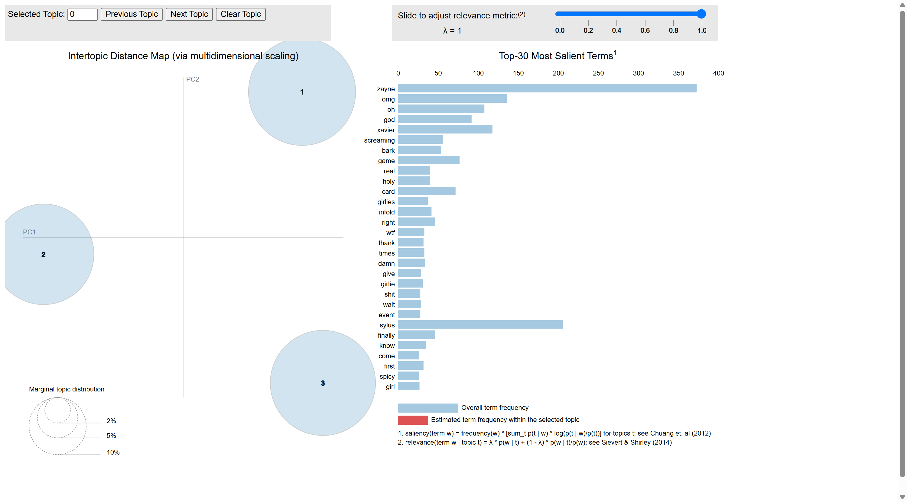

# YouTube Comment Analysis

A Python script for analyzing YouTube comments using NLP, sentiment analysis, and topic modeling.

## Overview

This script demonstrates a full text analysis pipeline for social media comments, including:

- Data cleaning and language filtering
- Word count and all-caps detection (emotional intensity indicators)
- Part-of-speech (POS) tagging and distribution analysis
- Tokenization, stopword removal, and frequency analysis
- Sentiment analysis (VADER)
- Word cloud visualization
- Topic modeling (LDA) with coherence evaluation
- Interactive topic visualization (pyLDAvis)

## Requirements

    pip install -r requirements.txt

## Input

The script expects a CSV file with YouTube comments at:

    data/youtube_comments.csv

The file must contain at least the following columns:

| Column | Description |
|--------|-------------|
| Comment | Comment text |
| Level | Comment level (L1 for top-level) |

You can generate this file using the companion scraper:
https://github.com/wu-wu33/youtube-comment-scraper

Place the CSV file in the `data/` folder, or update `INPUT_PATH` at the top of the script.

## Usage

    python youtube_analysis.py

The script outputs the following files:

- `youtube_comments_with_wordcount.csv`
- `youtube_comments_with_upper_flag.csv`
- `youtube_comments_with_pos.csv`
- `youtube_pos_counts.csv`
- `youtube_comments_with_sentiment.csv`
- `word_frequency_youtube.csv`
- `wordcloud.png`
- `coherence_vs_k.png`
- `youtube_lda_bubbles.html`

## Pipeline

### 1. Data Cleaning

- Filter to English comments only
- Remove @username mentions
- Keep only top-level (L1) comments

### 2. Word Count and All-Caps Detection

- Count words per comment
- Flag comments written entirely in uppercase (used as an emotional intensity indicator)

### 3. POS Tagging

- NLTK POS tagging for each comment
- Aggregate POS distribution across the corpus

### 4. Tokenization and Stopword Removal

- NLTK word tokenization
- Remove stopwords (default + custom list)
- Keep domain-specific terms in a whitelist

### 5. Sentiment Analysis

- VADER sentiment scoring (compound score)
- Classify comments as positive, neutral, or negative

### 6. Word Frequency and Word Cloud

- Compute token frequency
- Generate a word cloud from the most frequent tokens

### 7. Topic Modeling

- LDA with K ranging from 2 to 10
- Evaluate with coherence (c_v)
- Select optimal K and display top terms per topic

### 8. Topic Visualization

- pyLDAvis interactive bubble chart

## Topic Model Visualization

### Interactive LDA Bubble Chart

**How to read this chart:**

- Each bubble represents one topic
- Bubble size indicates the topic's prevalence in the corpus
- Click a bubble to see its top terms
- Adjust the λ slider to balance term frequency vs. exclusivity
- Hover over terms to see their frequency

For the interactive version, download [`youtube_lda_bubbles.html`](youtube_lda_bubbles.html) and open it in your browser.

## Configuration

Key parameters at the top of `youtube_analysis.py`:

| Parameter | Description |
|-----------|-------------|
| `INPUT_PATH` | Path to the input CSV file |
| `PRESERVE_WORDS` | Words to keep even if in stopword list |
| `CUSTOM_STOPWORDS` | Custom stopwords for this corpus |
| `K_RANGE` | Range of topic numbers to evaluate |
| `BEST_K` | Final number of topics |
| `RANDOM_STATE` | Random seed for reproducibility |

## Notes

- Adjust `min_df` and `max_df` in `CountVectorizer` based on your corpus size.
- VADER thresholds: compound ≥ 0.05 → positive; ≤ -0.05 → negative; otherwise neutral.
- The optimal number of topics should be validated with coherence scores.

## Disclaimer

This script is intended for academic research purposes only. Users are responsible for complying with the platform's terms of service and applicable data protection laws.

## Contact

florencewu103@gmail.com
